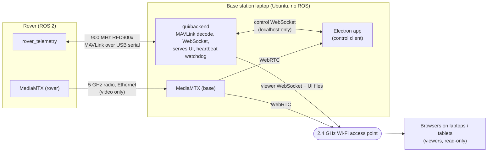
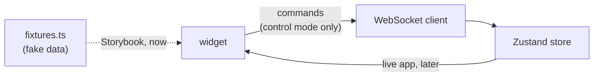

# Base station GUI architecture

How the base station GUI is put together: what runs where, who can control the rover, what happens when links drop, and how the frontend is split into widgets. For setup and commands, see [GUI setup](../setup/gui.md). For the rest of the system, see the [system overview](../system/overview.md).

## Overview

- One React + TypeScript UI (`gui/frontend`) runs in two places:
  - **Control mode:** inside an Electron app on the base station laptop. It's the only client that can command the rover.
  - **Viewer mode:** in a browser on any device on the base Wi-Fi. It's read-only.
- A Python backend (`gui/backend`) on the same laptop decodes MAVLink from the radio, streams telemetry to both kinds of client, and serves the built UI to viewers.
- The UI is built from self-contained widgets. Each widget is designed in Storybook against fake data, so frontend work doesn't wait for the rover or the backend.

## System layout



- The laptop is the only machine on both the rover links and the viewer network. It doesn't route traffic between them, and the rover-side interface has no default gateway.
- The base network is 2.4 GHz Wi-Fi. URC 2027 puts no frequency restrictions on 2.4 GHz (rule 2.c.vi), but expect interference from teams on nearby courses: use a low-power access point with automatic channel selection. Don't use a 5 GHz access point, because it could interfere with our own 5 GHz video link.
- The access point is communications equipment: list it in the comms documentation due Apr 30, 2027 (rule 2.c.ii), and power it down with the radios when we're not competing (rule 2.c.i).
- The field has no internet. The UI bundles everything it needs: no CDNs, web fonts or online map tiles.

The [video](../system/video.md) and [science](../system/science.md) pages show the same split between the Electron app and viewers.

## Control model

The backend has two entry points:

| Entry point | Listens on | Who can reach it | What it allows |
| ----------- | ---------- | ---------------- | -------------- |
| Control | `localhost` only | Electron app on the base laptop | All commands: drive, arm, mode changes, software stop, buttons |
| Viewer | Wi-Fi network | Any device on the base Wi-Fi | UI files, telemetry stream, video. No commands |

- The network setup enforces control: Wi-Fi devices can't reach the control port at all. The UI also disables controls in viewer mode, but that's only cosmetic.
- There's no handover or locking logic. The base laptop is always the controller.
- The UI works out its own mode. The Electron preload script exposes a flag; if the flag is missing, the UI assumes viewer mode.
- Optional (undecided): Electron passes a startup token to the backend, so a stray browser tab on the laptop itself can't take control.

## Failsafes

| Situation | Behavior |
| --------- | -------- |
| Base link lost, **teleop** | The rover stops drive and arm and holds position. The rover decides this itself. |
| Base link lost, **autonomous** | The rover **keeps going** with the mission, logs locally, and sends its state and missed logs when the link returns. Links are expected to drop: some targets are deliberately out of line of sight (rule 1.e.xvi). |
| Electron app stops sending heartbeats (frozen or crashed) during teleop | The backend sends the rover a stop. |
| Electron app stops sending heartbeats during autonomy | Nothing is sent; autonomy continues. |
| Emergency | The red physical E-stop on the rover cuts power to all systems (rule 2.a.v). There's no physical stop button at the base. |

What this means for the UI:

- Abort and return commands during autonomy only work while the link is up, so every screen shows link state clearly at all times.
- Every screen shows the current mode (Teleop / Autonomous / Idle) prominently. Mode changes go through the control port only, and the team tells the judge when entering or leaving autonomy.
- Optional (undecided): onboard autonomy limits, such as a maximum time and/or a geofence. If exceeded, the rover stops and waits.

## Frontend architecture

### Shell and screens

The UI doesn't have to fit on one monitor. It's split into **screens**: full-window layouts, each opened in its own window so it can go on its own monitor.

| Screen | Layout | Opened |
| ------ | ------ | ------ |
| `main` | Left panel, map in the center, right panel | At startup |
| `video` | Grid of video tiles | From the **VIDEO** button in the main screen's top bar |
| `debug` (planned) | Debug tools | Only in **debug mode**, never in mission mode |

- Every screen has the same top bar: name, top-bar widgets (link status), mode and window buttons. So each window shows link state and mode on its own.
- The URL hash picks the screen: `#/video` is the video screen, no hash is `main`. In Electron each screen opens as its own window, at most one per screen, and closing the main window closes the others. Browser viewers open screens as new tabs, e.g. `http://<base>/#/video`.
- Each window will hold its own connection to the backend, which streams the same data to every client. Windows don't pass data to each other.
- Layouts are fixed for v1. Side panels will collapse; a docking or rearrangeable layout can come later.
- Later: remember each window's monitor and position, and reopen windows there.

**Debug vs mission mode (planned).** A debug screen for development tools, which can only be opened in debug mode, not in mission mode. Debug/mission mode is a separate setting from control/viewer mode and still needs defining: how it's switched, and what else it gates.

### Widgets

Every feature is a self-contained widget folder with its component, Storybook stories, a `data.ts` type for the data it needs and `fixtures.ts` fake data. The shell builds its layout from a **widget registry**, so adding a widget never means editing other widgets. Every widget knows whether it's in control or viewer mode and disables its controls in viewer mode.

The widgets' `data.ts` files are the input to the message schema: the telemetry and command messages are designed from them and the MAVLink dialect.

See [widgets.md](widgets.md) for how to write one.

### Data flow



Widgets are built against `fixtures.ts` first. Later, a WebSocket client fills a Zustand store, which also tracks link health, and widgets switch from fixtures to live data. The backend will have a mock/replay mode for bench testing without the rover.

### Design

The look is a dark, dense, map-centered operator console. See [design.md](design.md).

## Tech stack

Decided 2026-11-19. Don't add frontend libraries outside this list without checking with Ethan.

**Frontend (`gui/frontend`)**

| Layer | Choice |
| ----- | ------ |
| Desktop shell | Electron + electron-vite (Vite does the bundling) |
| UI | React + TypeScript (strict) |
| Package manager | pnpm, version pinned with the `packageManager` field |
| Styling | Tailwind CSS; design tokens live in the Tailwind theme |
| Components | Radix UI primitives via shadcn, restyled to our look |
| State | Zustand |
| Map | MapLibre GL with offline tiles |
| Plots | uPlot |
| Widget workbench | Storybook |
| Lint / format | ESLint + Prettier |

**Backend (`gui/backend`)**

| Layer | Choice |
| ----- | ------ |
| Language | Python 3.13 (planned; `pyproject.toml` currently allows 3.12+). There's no ROS on the base station, so it isn't tied to Ubuntu 24.04's 3.12. |
| Framework | FastAPI (WebSockets, serves the built UI) |
| MAVLink | pymavlink (MAVLink 2), code generated from [`mavlink/rover.xml`](../system/mavlink.md) |
| Environment / dependencies | uv |
| Lint / format / types | Ruff + mypy |

**Repo-wide**

| Item | Choice |
| ---- | ------ |
| Git hooks | Lefthook, configured in `lefthook.yml` at the repo root. On commit: lint and format staged files (ESLint/Prettier for TS, Ruff for Python). On push: type checks (`tsc`, mypy). CI runs the same checks, since hooks can be skipped. GUI checks only run when GUI files change. |
| Dev environment | Native on macOS, Windows or Linux for GUI work. WSL/Ubuntu is only for the ROS workspace. |
| Base station OS | Ubuntu. The Electron app is packaged as an AppImage or .deb (a later release step). |

## Code layout

```
gui/
├── backend/
│   ├── app/                  # Python package (import as `app`)
│   │   └── generated/        # mavgen output, don't hand-edit
│   ├── scripts/              # gen_mavlink.sh
│   └── pyproject.toml
└── frontend/
    ├── .storybook/
    └── src/
        ├── main/             # Electron main process
        ├── preload/          # exposes the control/viewer mode flag
        └── renderer/src/
            ├── app/          # screens, top bar, mode, widget registry (registry.ts)
            ├── design/       # base components: Panel, SectionHeader, StatusPill, Button, DataField, TopBar
            ├── data/         # Zustand store; later the WebSocket client
            └── widgets/      # one folder per widget, see widgets.md
```

## Widget backlog

To be finalized after going through last year's GUI (URC-2026 repo, `base-station-gui-v2` branch). That GUI is a reference for the widget list only; don't port its code.

- Top status bar: mode, UTC clock, 900 MHz / 5 GHz link health, viewer count
- Drive teleop: Xbox controller input, drive readouts, arm/drive toggle state
- Arm teleop: joint readouts, controller mapping display
- Software stop and mode control (control mode only)
- Map: rover position and track, waypoints, offline tiles
- Autonomy: mission and target list, autonomy state, abort/return
- Science: high-resolution sample-site photo capture and viewer
- Video tiles
- Telemetry plots: battery, IMU, motor currents
- Event log / console

## Open questions

- Startup token for Electron: needed, or is "the laptop is the controller" enough?
- Autonomy onboard limits: maximum time, geofence, or neither?
- Debug vs mission mode: how it's switched, and what besides the debug screen it gates.
- Video server: MediaMTX is proposed.
- Offline map tile source and zoom levels for MDRS.
- Docking or rearrangeable layout library (not needed for v1).
