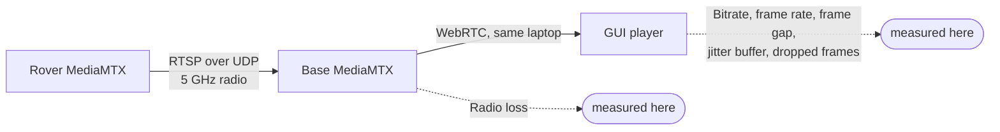

# Video feed widget

The video screen's tiles (`gui/frontend/src/renderer/src/widgets/video-feed/`) each play one rover camera from MediaMTX over WebRTC and show how healthy the stream is. There's one tile per camera, `rover/front` (ZED 2i) and `rover/arm` (OV9281), side by side; each has its own camera choice, stats and reload. To give each camera its own monitor, open **VIDEO · FRONT** and **VIDEO · ARM** from the main screen's top bar: each opens a window with just that tile (`#/video/front`, `#/video/arm`). A tile's camera choice is saved per tile, not per window: the arm tile in its own window and in the both-cameras window start from the same saved choice, and a change in one shows in the other the next time it opens. For how video gets from the rover to the GUI, see [Video](../system/video.md).

## Header

`ROVER/FRONT  PLAYING   30 fps · 1280×720 · 1.8 Mb/s · buf 8 ms   FRONT  ARM  RELOAD  STATS  SOURCE`

| Part | Meaning |
| ---- | ------- |
| Status pill | `CONNECTING` (first try), `PLAYING`, `RECONNECTING` (was playing, dropped) or `FAILED` (waiting to retry) |
| Stats line | Decoded fps, frame size, bitrate and jitter buffer over the last second; freezes since the stream connected |
| **FRONT** / **ARM** | Switches this tile to that camera on the same server. The highlighted one is playing |
| **RELOAD** | Drops the connection and opens a new one at once, like a browser's reload. Also clears the graphs |
| **STATS** | Opens the stats panel to the right of the video. Drag its left edge to resize it |
| **SOURCE** | This tile's MediaMTX address and stream path, for anything the camera buttons don't cover, e.g. playing straight from the rover's MediaMTX (`http://192.168.1.67:8889`). Defaults to the base station, `http://<this machine>:18889`, and the tile's own camera. Saved per tile, per browser or Electron profile |

The widget reconnects on its own when the stream drops, so RELOAD is only needed to skip a retry wait.

## When there's no video

The backend probes the rover every 2 s, so the tile can say why there's no video:

| Message | What's wrong | Check |
| ------- | ------------ | ----- |
| Backend not running | Nothing answers on port 8000, so the base MediaMTX isn't running either | Start the backend ([GUI setup](../setup/gui.md#run-the-backend)) |
| Base MediaMTX not running | The backend is up but couldn't start MediaMTX | The backend's log; `gui/backend/bin/mediamtx` exists |
| Rover unreachable at 192.168.1.67 | The rover doesn't answer over the 5 GHz link. The top bar's 5 GHz badge also turns red | Radio link, rover power |
| Rover isn't streaming rover/front | The rover answers, but nothing publishes that path on it | Is `ros2 launch rover_bringup video.launch.py` running? |
| Rover isn't streaming rover/arm | The same, for the arm camera | Was the launch started with `arm_camera:=true`, and is the OV9281 plugged in? |

## Stats panel

Six graphs of the last 60 s, one point per second. Hovering one graph shows the same moment on all of them. Each y-axis fits its data, so read the numbers on the axis: a line that fills a graph may be a small change.

The graphs measure two different hops:

The base and the GUI run on the same laptop, so the WebRTC hop between them never loses packets. Problems on the radio show up in the GUI's graphs as missing or late frames.

| Graph | What it is | Normal | Look out for |
| ----- | ---------- | ------ | ------------ |
| **Radio loss** | Red: RTP packets lost between the rover and the base per second. Amber: frames the base received damaged. From the backend | 0, with an occasional single packet | Steady loss: weak or noisy radio link. Each lost packet smears part of the picture until the next keyframe (at most 1 s) |
| **Bitrate** | Video arriving in the GUI, Mb/s | About the rover's setting (2 Mb/s), dipping on simple scenes | Drops toward 0: the radio or the rover stalled. A spike right after a drop: packets the radio held back arriving all at once |
| **Frame rate** | Frames decoded per second | 29–31 | Dips: frames missing or late |
| **Longest frame gap** | The longest time between two frames shown on screen in each second, ms | 33–67. The screen redraws every 16.7 ms, so a 30 fps frame is shown every 33 ms, and a frame that's a little late waits for the next redraw (50) or the one after (67) | Hundreds of ms or more: a freeze you can see. This is the most direct freeze measure |
| **Jitter buffer** | How long frames wait in the GUI before being shown, averaged over the second, ms. Latency the GUI adds | Under about 20 | Climbing: arrival is uneven and the player is holding frames to smooth it, which adds delay |
| **Dropped frames** | Frames the GUI received but didn't show, per second | 0 | Non-zero: the player skipped frames, e.g. too late to be worth showing |

The frame gap is only measured while the window is on screen: hidden or minimized windows don't draw frames, so the graph shows nothing for that time.

### Reading a freeze

| Pattern | Likely cause |
| ------- | ------------ |
| Frame gap spikes, bitrate drops to 0 and then spikes, no radio loss, frame rate jumps above 30 just after | The radio held packets (link-layer retries during a fade) and delivered them in a burst. The video freezes, then plays the held frames quickly |
| Frame gap spikes, bitrate drops, radio loss climbs | Packets were lost on the radio. Expect smearing until the next keyframe |
| Frame gap spikes, bitrate drops to 0, no burst after, no radio loss | The rover stopped sending: camera, encoder or rover MediaMTX stalled |
| Frame gap and dropped frames spike, bitrate and radio loss normal | The GUI side couldn't keep up: laptop busy or window being moved |
