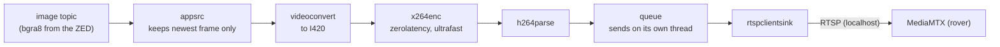

# Video stream manager

`video_stream_manager` (in `rover_ros2_ws/src/embedded/`) encodes a camera image topic to H.264 and publishes it over RTSP to the rover's MediaMTX. From there, MediaMTX handles the 5 GHz link and the viewers (see [Video](../system/video.md)).

It's a component (`video_stream_manager::StreamManager`). On the rover it runs in the same process as the ZED driver, so frames arrive without serialization and are handed to GStreamer without a copy.

## Pipeline



- **No hardware encoder.** The Jetson Orin Nano has no NVENC, so x264 encodes on the CPU. At 1280x720, 30 fps and 2 Mbit/s it used about 30% of one core in the prototype.
- **Latency over smoothness.** The appsrc holds one frame. If the encoder falls behind, the older frame is dropped instead of queued.
- **WebRTC-compatible output.** No B-frames, constrained-baseline profile, and SPS/PPS before every keyframe so a viewer can join mid-stream. These settings come from the [video prototype](../../prototypes/video/README.md) on the `ethnjs/comms/zed-jetson-prototype` branch.
- **Recovers on its own.** If MediaMTX isn't running or restarts, the pipeline stops and is rebuilt on the next frame after `retry_period`. A change in image size or encoding also rebuilds it.

## Topics and parameters

Subscribes to `image` (`sensor_msgs/Image`, sensor-data QoS). Remap it to the camera topic, e.g. `image:=/zed/zed_node/rgb/color/rect/image`.

Supported encodings: `bgra8`, `rgba8`, `bgr8`, `rgb8`, `mono8`, `yuv422`, `yuv422_yuy2`.

| Parameter | Default | Meaning |
| --- | --- | --- |
| `rtsp_url` | `rtsp://127.0.0.1:8554/rover/front` | MediaMTX path to publish to |
| `rtsp_protocols` | `tcp` | Transport to MediaMTX. It's localhost, so TCP costs nothing. |
| `bitrate_kbps` | `2000` | x264 target bitrate |
| `fps` | `30` | Expected input frame rate. Sets the default keyframe interval. |
| `keyframe_interval` | `0` | Frames between keyframes. `0` means one per second. |
| `x264_threads` | `0` | x264 threads. `0` lets x264 choose. |
| `retry_period` | `2.0` | Seconds to wait before rebuilding a failed pipeline |

Parameters are read at startup. Changing bitrate and resolution at runtime from the GUI is planned (see [Video](../system/video.md)) but not built yet.

## Run

The rover's MediaMTX must be running. Until the bringup launch exists, use the prototype's config: `./rover/start-rover.sh` starts both MediaMTX and the prototype publisher, so run MediaMTX on its own instead:

```bash
prototypes/video/bin/mediamtx prototypes/video/rover/mediamtx-rover.yml
```

**On the Jetson with the ZED.** Start the wrapper as in [Rover setup](../setup/rover.md#third-party-packages-jetson-only), then:

```bash
ros2 run video_stream_manager stream_manager_node --ros-args -r image:=/zed/zed_node/rgb/color/rect/image
```

This runs it as a separate process, so frames are serialized between the wrapper and the node. That's fine for testing. The bringup launch will load both into one container.

**Without a camera.** Any image topic works, e.g. the test images from `image_tools`:

```bash
ros2 run image_tools cam2image --ros-args -p burger_mode:=true -p frequency:=30.0
ros2 run video_stream_manager stream_manager_node
```

`cam2image` publishes on `image`, so no remap is needed.

Then open `http://<rover IP>:8889/rover/front` in a browser.
