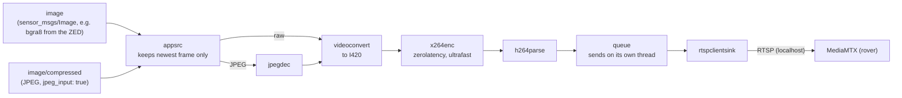

# Video stream manager

`video_stream_manager` (in `rover_ros2_ws/src/embedded/`) encodes a camera image topic to H.264 and publishes it over RTSP to the rover's MediaMTX. From there, MediaMTX handles the 5 GHz link and the viewers (see [Video](../system/video.md)).

It's a component (`video_stream_manager::StreamManager`), and each camera gets its own instance in the same process as its driver, so frames arrive without serialization and are handed to GStreamer without a copy:

| Camera | Container | Driver | Stream manager input | MediaMTX path |
| --- | --- | --- | --- | --- |
| ZED 2i (front) | `/zed/camera_container` | zed-ros2-wrapper | `image`, `bgra8` | `rover/front` |
| OV9281 (arm) | `/arm_camera/camera_container` | [`mjpeg_camera`](#arm-camera-ov9281) | `image/compressed`, JPEG | `rover/arm` |

Each camera has its own container, so one camera's process failing doesn't stop the other's stream.

## Pipeline



- **No hardware encoder.** The Jetson Orin Nano has no NVENC, so x264 encodes on the CPU. With both cameras streaming at 1280x720, 30 fps and 2 Mbit/s, the two camera containers peaked at about 58% and 39% of one core (out of 600% on the Orin Nano's 6 cores). Those figures include the ZED SDK and the JPEG decoding.
- **Latency over smoothness.** The appsrc holds one frame. If the encoder falls behind, the older frame is dropped instead of queued.
- **WebRTC-compatible output.** No B-frames, constrained-baseline profile, and SPS/PPS before every keyframe so a viewer can join mid-stream. These settings come from the [video prototype](../../prototypes/video/README.md) on the `ethnjs/comms/zed-jetson-prototype` branch.
- **Recovers on its own.** If MediaMTX isn't running or restarts, the pipeline stops and is rebuilt on the next frame after `retry_period`. A change in image size or encoding also rebuilds it.
- **JPEG input skips a round trip.** For an MJPEG camera the driver publishes the camera's JPEGs untouched and `jpegdec` decodes them straight to I420 for x264. Decoding in the driver to `mono8` or `rgb8` instead would copy a full raw frame through ROS and convert it back to I420. In a laptop test, the decode-in-driver path (decoding all 60 fps, then dropping to 30) used about 31% of a core; dropping to 30 fps first and decoding straight to I420 used about 10%.

## Topics and parameters

Subscribes (sensor-data QoS) to one of:

- `image` (`sensor_msgs/Image`), by default. Remap it to the camera topic, e.g. `image:=/zed/zed_node/rgb/color/rect/image`. Supported encodings: `bgra8`, `rgba8`, `bgr8`, `rgb8`, `mono8`, `yuv422`, `yuv422_yuy2`.
- `image/compressed` (`sensor_msgs/CompressedImage`) when `jpeg_input` is true. The format must contain `jpeg`.

| Parameter | Default | Meaning |
| --- | --- | --- |
| `rtsp_url` | `rtsp://127.0.0.1:8554/rover/front` | MediaMTX path to publish to |
| `rtsp_protocols` | `tcp` | Transport to MediaMTX. It's localhost, so TCP costs nothing. |
| `jpeg_input` | `false` | Subscribe to JPEG `image/compressed` instead of raw `image` |
| `bitrate_kbps` | `2000` | x264 target bitrate |
| `fps` | `30` | Expected input frame rate. Sets the default keyframe interval. |
| `keyframe_interval` | `0` | Frames between keyframes. `0` means one per second. |
| `x264_threads` | `0` | x264 threads. `0` lets x264 choose. |
| `retry_period` | `2.0` | Seconds to wait before rebuilding a failed pipeline |

Parameters are read at startup. Changing bitrate and resolution at runtime from the GUI is planned (see [Video](../system/video.md)) but not built yet.

## Run

The rover's MediaMTX must be running first. It isn't part of the ROS launch: it runs as a systemd service that starts at boot, so it keeps running when the ROS launch restarts (see [MediaMTX service](#mediamtx-service)).

`rover_bringup` has one launch file per camera and `video.launch.py`, which includes both:

| Launch file | Starts | Arguments |
| --- | --- | --- |
| `video.launch.py` | the front camera, and the arm camera with `arm_camera:=true` | all of the below; `arm_camera_device` is passed on as `device` |
| `front_camera.launch.py` | ZED wrapper + stream manager in `/zed/camera_container` | `camera_model` (`zed2i`), `test_source`, `intra_process`, `log_level` |
| `arm_camera.launch.py` | `mjpeg_camera` + stream manager in `/arm_camera/camera_container` | `device`, `intra_process`, `log_level` |

**On the Jetson** (after [importing the ZED wrapper](../setup/rover.md#third-party-packages-jetson-only)):

```bash
ros2 launch rover_bringup video.launch.py arm_camera:=true   # both cameras
ros2 launch rover_bringup video.launch.py                    # ZED only
ros2 launch rover_bringup arm_camera.launch.py               # arm camera only
```

Settings are in `rover_bringup/config/`: `zed_video.yaml` turns off depth, positional tracking and mapping; `video_stream_manager.yaml` sets the front stream's bitrate and MediaMTX URL; `arm_camera.yaml` sets the arm camera's capture mode and its stream. Add `log_level:=debug` for more output, or `intra_process:=false` to pass frames through DDS as if the nodes were separate processes (for debugging).

If the ZED container exits, the whole launch ends, so a supervisor can restart it. The arm container doesn't do that: the arm camera reopens itself when it's unplugged (see [Arm camera](#arm-camera-ov9281)), and a crash there leaves the front stream running.

**Without the ZED**, e.g. on a laptop without the ZED SDK:

```bash
ros2 launch rover_bringup video.launch.py test_source:=true
```

This streams moving test images from `image_tools` through the front camera's container and pipeline. Add `arm_camera:=true` if the OV9281 is plugged into the laptop.

**The node on its own**, for debugging:

```bash
ros2 run video_stream_manager stream_manager_node --ros-args -r image:=/zed/zed_node/rgb/color/rect/image
```

Then open `http://<rover IP>:8889/rover/front` (or `rover/arm`) in a browser.

## Arm camera (OV9281)

The arm camera is an OV9281 USB module. Things about it that are easy to get wrong:

- **Monochrome.** The OV9281 sensor has no color filter. Its JPEGs have three channels, but they're all grey, and turning up the Saturation control doesn't change that. The color version of the same module uses an OV9782.
- **MJPEG only, no raw modes.** It offers 1280x720, 800x600 and 640x480, each at 60 or 120 fps. Nothing slower than 60 fps.
- **USB 2.0** (480 Mbit/s), UVC. It shows up as USB `32e6:9251`, "openaicam", and on the rover as `/dev/v4l/by-id/usb-openaicam_openaicam_5423534724-video-index0`. Use that path, not `/dev/videoN`, which can change between boots. A different unit has a different serial in the path.

`mjpeg_camera` (in `rover_ros2_ws/src/embedded/`) is its driver: a component (`mjpeg_camera::MjpegCamera`) that captures with GStreamer (`v4l2src ! image/jpeg ! videorate ! appsink`) and publishes each JPEG, undecoded, as `sensor_msgs/CompressedImage` (`format: jpeg`) on `image_raw/compressed`. Each frame is copied once, from GStreamer's buffer into the message, and the message goes to the stream manager in the same process without another copy. When the camera fails or is unplugged, it closes the pipeline and reopens the device every `retry_period`; it never exits, so its container doesn't need restarting.

| Parameter | Default | `arm_camera.yaml` | Meaning |
| --- | --- | --- | --- |
| `device` | `/dev/video0` | set by `arm_camera.launch.py` | V4L2 device |
| `width`, `height` | `1280`, `720` | `1280`, `720` | Capture size; must be a mode the camera offers |
| `camera_fps` | `30` | `60` | Capture frame rate; must be a rate the camera offers for that size |
| `fps` | `30` | `30` | Published frame rate. Lower than `camera_fps` drops frames before publishing. |
| `frame_id` | `camera` | `arm_camera` | Header frame |
| `retry_period` | `2.0` | | Seconds between attempts to reopen the camera |

`gscam` and `usb_cam` were considered and not used: `usb_cam` only decodes MJPEG to `rgb8`, and `gscam` shuts its whole process down when the camera fails, which would take the stream manager in the same container with it.

## Troubleshooting

- **ZED: `Error opening camera: CAMERA NOT DETECTED`** while `/dev/v4l/by-id/` still lists the ZED. Check `lsusb -t`: the ZED's `Class=Video` lines must be on the USB 3 bus (10000M root hub) at **5000M**. If they're at 480M, the link fell back to USB 2 and the ZED SDK won't open it. Flip the USB-C plug at the camera 180° and reseat both ends, and use the ZED's own cable straight into the Jetson. A loose plug causes this, so secure the cable on the rover.
- **Arm stream says no stream available.** Look for `Can't open /dev/v4l/by-id/...` from `/arm_camera/camera`: the camera isn't plugged in, or another program has it open. It reopens by itself once the camera is free.

## MediaMTX service

The config, systemd unit and installer are in `rover_ros2_ws/src/bringup/rover_bringup/mediamtx/`. The config has one path per camera (`rover/front`, `rover/arm`). On the Jetson:

```bash
sudo rover_ros2_ws/src/bringup/rover_bringup/mediamtx/install.sh
```

It downloads the pinned MediaMTX release (checking its SHA-256) to `/usr/local/bin/mediamtx`, copies `mediamtx.yml` to `/etc/mediamtx/`, and enables and starts the `mediamtx` service. Rerun it after editing `mediamtx.yml`. `--uninstall` removes everything it installed.

```bash
systemctl status mediamtx        # running?
journalctl -u mediamtx -f        # logs
sudo systemctl stop mediamtx     # stop until next boot
sudo systemctl disable mediamtx  # don't start at boot
```

With no stream published, MediaMTX sits idle, so it can stay on while you test other subsystems.

To test on a laptop without installing the service, run a MediaMTX binary with this config directly, e.g. the base station's (see [GUI setup](../setup/gui.md#base-station-video)): `gui/backend/bin/mediamtx rover_ros2_ws/src/bringup/rover_bringup/mediamtx/mediamtx.yml`. Use a `ROS_DOMAIN_ID` other than the rover's (see [Rover setup](../setup/rover.md#ros-domain)).
