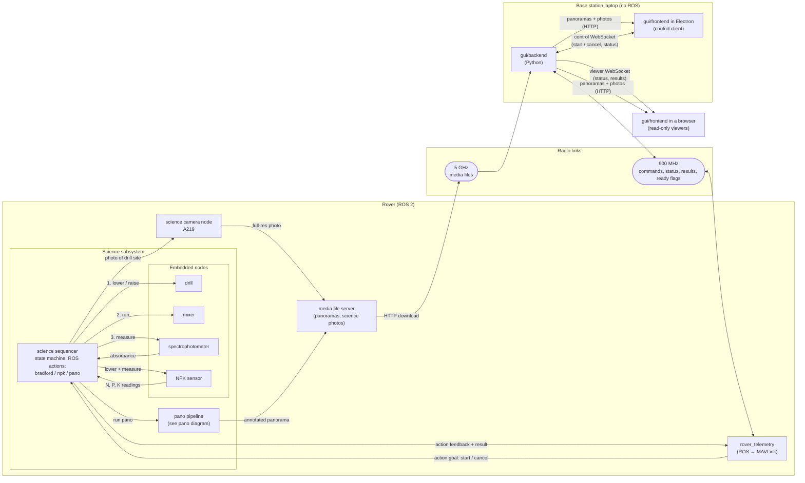
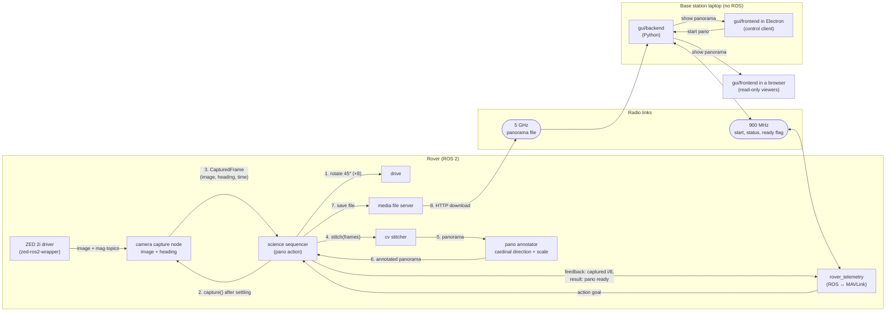

# Science

The science sequencer on the rover runs each science task as a ROS action: **bradford**, **npk** and **pano**. The GUI starts and cancels them from the Electron app; status, results and ready flags come back over 900 MHz, and the large files (panoramas, full-resolution photos) are downloaded over 5 GHz.

## Science sequences

## Panorama

The pano sequence rotates the rover 45° eight times, captures a frame with its heading after each turn, stitches the frames, and annotates the panorama with cardinal directions and scale.

