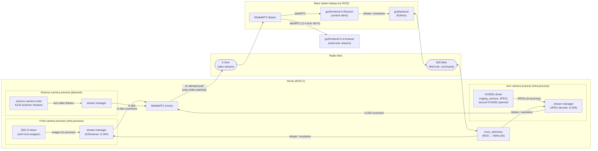

# Video

Rover cameras reach the GUI over the 5 GHz link; the 900 MHz link only carries the controls.

- Each camera runs in its own process (component container) with its own stream manager, so frames reach the encoder without serialization and one camera failing doesn't stop the others. Each stream manager encodes H.264 to its own MediaMTX path: `rover/front` (ZED 2i) and `rover/arm` (OV9281). See [Video stream manager](../rover/video-stream-manager.md).
- The rover's MediaMTX only sends a stream over 5 GHz while someone is watching it (on-demand pull).
- The base MediaMTX pulls each stream from the rover as RTSP over UDP, so a lost packet damages one frame instead of stalling the stream while TCP retransmits. It serves the streams over WebRTC (port 18889) to the Electron app and to browser viewers.
- `gui/backend` starts the base MediaMTX, restarts it if it exits and stops it on shutdown (see [GUI setup](../setup/gui.md#base-station-video)). Video itself doesn't go through the backend. The config is `gui/backend/mediamtx/mediamtx.yml`.
- The GUI's [video feed widget](../gui/video-feed.md) plays the streams and graphs the link's health.
- Bitrate and resolution are commands, so only the Electron app can change them. They travel over 900 MHz as MAVLink commands (see [MAVLink dialect](mavlink.md)).

