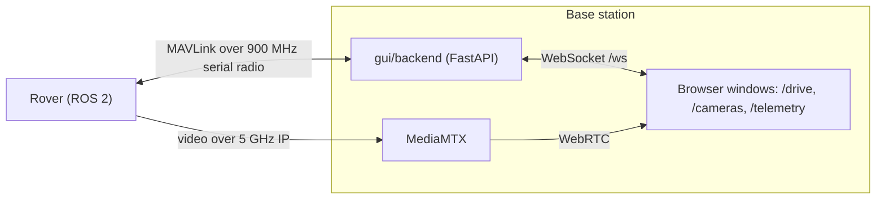

# Base station GUI

The browser dashboard the operators use at the base station. **It doesn't run ROS.** The backend talks MAVLink to the rover over the 900 MHz telemetry radio and serves the frontend over WebSockets. Video uses a separate 5 GHz IP link (MediaMTX → WebRTC) and doesn't go through the backend.

> **Status: skeleton.** The project structure, dependencies, and generated MAVLink code are in place. The backend server and frontend features aren't built yet.



## Tech stack

| Part | Stack |
| ---- | ----- |
| `backend/` | Python 3.12, [uv](https://docs.astral.sh/uv/), FastAPI + Uvicorn, pymavlink (MAVLink 2), Pydantic v2 + pydantic-settings, pyserial, pytest, ruff |
| `frontend/` | Node 22, Vite, React 19, TypeScript, React Router 7, oxlint |
| MAVLink | Dialect in [`../mavlink/rover.xml`](../mavlink/README.md), Python code generated with `mavgen` |

Everything must run offline at the field: no CDNs or runtime downloads. Install dependencies before you leave.

## Layout

```
gui/
├── backend/
│   ├── app/               # Python package (import as `app`)
│   │   └── generated/     # mavgen output, don't hand-edit
│   ├── scripts/           # gen_mavlink.sh
│   └── pyproject.toml
└── frontend/
    └── src/
        ├── routes/        # one route per monitor: drive, cameras, telemetry
        ├── ws/            # WebSocket client and hooks
        └── generated/     # TS types generated from the backend models, don't hand-edit
```

## Setup

Use Ubuntu 24.04 (WSL works). You don't need ROS.

1. Install uv:
   ```bash
   curl -LsSf https://astral.sh/uv/install.sh | sh
   ```
2. Install Node 22, e.g. with [nvm](https://github.com/nvm-sh/nvm):
   ```bash
   nvm install 22
   ```
   On WSL, check that `which node` points inside Linux, not at a Windows install under `/mnt/c`.
3. Install dependencies:
   ```bash
   cd gui/backend && uv sync
   cd ../frontend && npm install
   ```

## Run

Frontend dev server at http://localhost:5173. It forwards `/ws` to the backend on port 8000.

```bash
cd gui/frontend
npm run dev
```

The backend server isn't implemented yet.

## Regenerate MAVLink code

After changing `mavlink/rover.xml`:

```bash
gui/backend/scripts/gen_mavlink.sh
```

Commit the regenerated `backend/app/generated/rover.py` with the XML change.

## Checks

Run before marking a PR ready:

```bash
cd gui/backend && uv run ruff check .
cd ../frontend && npm run lint && npm run build
```
