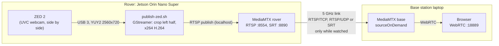

# Video pipeline prototype: ZED 2 → Jetson Orin Nano → 5 GHz → base station

A learning spike to prove the operator video path end to end and measure its latency before any ROS code is written. Shell scripts and config only.



It matches the real architecture (`docs/diagrams/video.mmd`): the GStreamer script stands in for the ROS stream manager, and MediaMTX's built-in WebRTC page stands in for the dashboard.

## The Orin Nano has no hardware video encoder

The Jetson Orin Nano (including the "Super" variant) has **no NVENC**. Only the Orin NX and AGX do. `nvv4l2h264enc` may still be installed, but it can't encode on this board. H.264 is therefore encoded on the CPU with **x264**, so encoder CPU load is the main thing to measure. The Jetson's VIC hardware can still do the crop and color conversion (`--convert vic`), which leaves more CPU for x264.

## Layout

```
prototypes/video/
├── README.md
├── install-mediamtx.sh      # downloads the pinned MediaMTX for this CPU into bin/
├── start-loopback.sh        # rover + base on one machine, for testing without the radio
├── rover/                   # runs on the Jetson
│   ├── setup-jetson.sh      # apt packages + MediaMTX + version/camera report
│   ├── mediamtx-rover.yml
│   ├── publish-zed.sh       # GStreamer: ZED -> crop -> x264 -> rover MediaMTX
│   └── start-rover.sh       # MediaMTX + publisher (auto-restarts the publisher)
├── base/                    # runs on the base station laptop
│   ├── mediamtx-base.yml    # template; ROVER_HOST is filled in by start-base.sh
│   ├── start-base.sh
│   └── paths-status.sh      # which paths are pulling, and who is reading
├── bin/                     # git-ignored: MediaMTX binary
└── logs/                    # git-ignored: logs + generated base config
```

## Versions

| Tool | Rover (Jetson) | Base (laptop) |
| --- | --- | --- |
| OS | JetPack _TBD_ (L4T _TBD_), Ubuntu 22.04 | Ubuntu 24.04.5 |
| GStreamer | _TBD_ | 1.24.2 |
| MediaMTX | v1.21.4 (linux_arm64) | v1.21.4 (linux_amd64) |
| x264 | _TBD_ | n/a |

`rover/setup-jetson.sh` prints the Jetson versions at the end. Copy them in here.

## Setup

### Rover (Jetson)

1. Clone the repo on the Jetson and check out this branch.
2. Plug the ZED 2 into a **USB 3** port. Check that it linked at 5000M with `lsusb -t`. At USB 2 speed, it can't deliver 2560x720.
3. Run the setup script. It installs GStreamer packages with apt, downloads MediaMTX, and lists the ZED's formats:
   ```bash
   cd prototypes/video
   ./rover/setup-jetson.sh
   ```
   Confirm `2560x720` YUYV at 30 fps appears in the format list. Don't assume it: other ZED firmware may list different modes. Side-by-side sizes are usually 4416x1242, 3840x1080, 2560x720 and 1344x376.
4. Put the Jetson in its highest power mode and lock clocks, so measurements are repeatable:
   ```bash
   sudo nvpmodel -q                         # current mode
   grep POWER_MODEL /etc/nvpmodel.conf      # list modes; pick MAXN SUPER
   sudo nvpmodel -m <id>
   sudo jetson_clocks
   ```

### Base station (laptop)

```bash
cd prototypes/video
./install-mediamtx.sh
```

The base doesn't need GStreamer. Any Chromium- or Firefox-based browser works.

### The 5 GHz link

1. Put the rover and base radios in bridge mode with both computers on the same subnet, and give each a static IP. Write the IPs here once they're chosen.
2. Test the link with `iperf3` before testing video. The video flows rover → base, so test in that direction:
   ```bash
   # rover
   iperf3 -s
   # base: UDP at the bitrate you plan to stream, reversed so the rover sends
   iperf3 -c <rover IP> -u -b 4M -t 30 -R
   ping -c 50 <rover IP>
   ```
   Record the loss % and the ping RTT. SRT's latency setting (`srtMinLatency` in `rover/mediamtx-rover.yml`, default 120 ms) should be about 4× the RTT.
3. If `ufw` is active on the rover, open the ports listed at the top of `rover/mediamtx-rover.yml`. Also allow the UDP ports on the base: RTSP/UDP sends media to ports the base picks at random.

## Running

**Rover:**

```bash
./rover/start-rover.sh                    # ZED, 1280x720 @ 30 fps, 2 Mbit/s
./rover/start-rover.sh --bitrate 1000     # options are passed to publish-zed.sh
./rover/start-rover.sh --convert vic      # crop/convert on VIC instead of CPU
./rover/start-rover.sh --test             # test pattern, no camera
./rover/publish-zed.sh --help             # all options
```

**Base:**

```bash
./base/start-base.sh <rover IP>
```

Then open one of these in a browser on the base:

| URL | Rover → base transport |
| --- | --- |
| `http://localhost:18889/rover/front` | RTSP over TCP |
| `http://localhost:18889/rover/front-udp` | RTSP over UDP |
| `http://localhost:18889/rover/front-srt` | SRT |
| `http://<rover IP>:8889/rover/front` | none: browser pulls directly from the rover over WebRTC (comparison only) |

**Without the radio:** `./start-loopback.sh --test` runs both sides on one machine, with the base pulling from `127.0.0.1`.

### Encoder settings

`publish-zed.sh` uses `x264enc tune=zerolatency speed-preset=ultrafast`. Other settings:

- `bframes=0`: WebRTC doesn't support B-frames.
- `key-int-max` = fps: a keyframe every second, so a new viewer starts within about 1 s.
- `profile=constrained-baseline`: every browser can decode it.
- `h264parse config-interval=-1`: repeats SPS/PPS before every keyframe, so viewers can join mid-stream.
- `vbv-buf-capacity=200`: caps keyframe size bursts, so keyframes don't spike latency on the radio.
- A leaky 1-frame queue before the encoder: if x264 falls behind, frames are dropped instead of queued, so latency doesn't grow.

## Verifying on-demand pulling

Run `watch -n1 ./base/paths-status.sh` on the base. `ready` = the base is pulling that path from the rover.

1. With no browser open, every base path should show `ready false`.
2. Open a viewer URL. Within about 1 s, that path should show `ready true`. Only that path, not the others.
3. Close the tab. About 10 s later (`sourceOnDemandCloseAfter`), it should go back to `ready false`.

`./base/paths-status.sh 9997` on the rover shows the matching reader on `rover/front`.

**Loopback result (2026-11-17, laptop, test pattern):** verified for all three transports. Before any viewer, all base paths showed `ready false`. With one RTSP reader on each base path, all three showed `ready true`, and the rover showed one reader per transport (`rtspSession, rtspSession, srtConn`). About 14 s after the readers left, all base paths were back to `ready false`. Base log:

```
12:54:24 INF [path rover/front-udp] [RTSP source] started on demand
12:54:24 INF [path rover/front-udp] stream is available and online, 1 track (H264)
12:54:30 INF [RTSP] [session d7a77df6] destroyed: not in use
```

_TBD: repeat over the 5 GHz link with a browser and paste the log lines here._

## Measuring latency

1. Show a millisecond stopwatch on a screen next to the base station monitor (or on a phone).
2. Point the ZED at the stopwatch, with the browser window showing the stream beside it.
3. Photograph both together. Latency = stopwatch time − time shown in the video. Take 5 photos and record the median.
4. While streaming, run `tegrastats` on the Jetson and record CPU % (all 6 cores) and the VIC load if using `--convert vic`.

Change one variable at a time: bitrate, transport, convert mode.

## Findings

_TBD: fill in from the Jetson + 5 GHz runs._

### Latency

All at 1280x720, 30 fps, x264 ultrafast, keyframe every 1 s, over the 5 GHz link unless noted.

| # | Path | Transport | Bitrate | Convert | Latency (median ms) | Jetson CPU % | Notes |
| - | --- | --- | --- | --- | --- | --- | --- |
| 1 | browser ← base ← rover | RTSP/TCP | 1 Mbit/s | cpu | | | |
| 2 | browser ← base ← rover | RTSP/TCP | 4 Mbit/s | cpu | | | |
| 3 | browser ← base ← rover | RTSP/UDP | 2 Mbit/s | cpu | | | |
| 4 | browser ← base ← rover | SRT (`srtMinLatency` = ___ ms) | 2 Mbit/s | cpu | | | |
| 5 | browser ← rover directly | WebRTC | 2 Mbit/s | cpu | | | |
| 6 | browser ← base ← rover | RTSP/TCP | 2 Mbit/s | vic | | | |

### Questions to answer

- **Encoder:** x264 on the CPU (the only option on the Orin Nano). How much CPU does it use at 720p30, and is there enough left for the ZED SDK, Nav2 and the other cameras? Does `--convert vic` help?
- **Latency:** how much does the base hop add over pulling directly from the rover? How do the transports compare on the real link?
- **On-demand:** did pulls start and stop as expected over the radio?
- **Surprises,** and anything that matters for the ROS stream manager.
